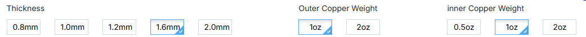
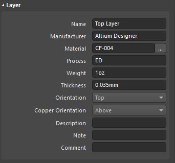
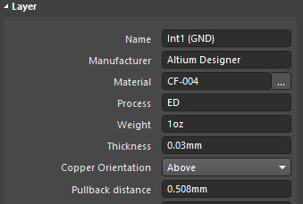
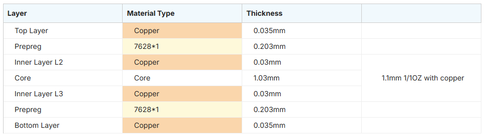
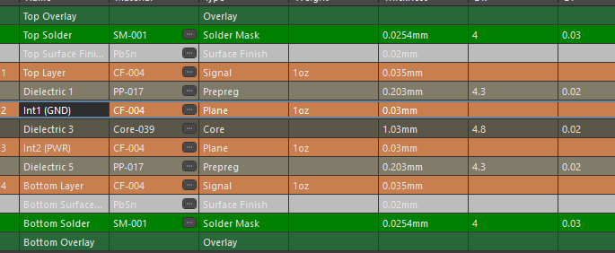
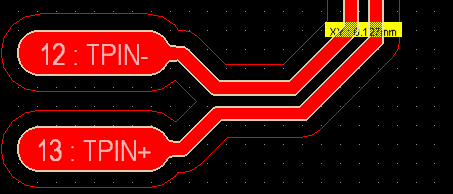
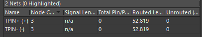
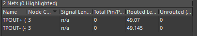
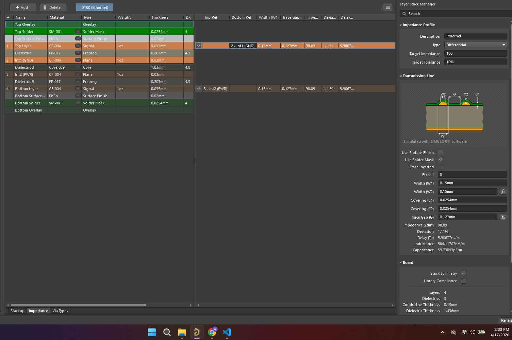

# Thực hành layout PCB mạch đo dòng và áp có Ethernet

## Mục tiêu

Bài tập này nhằm luyện kỹ năng thiết kế PCB có kiểm soát impedance cho tín hiệu Ethernet, đảm bảo tín hiệu truyền ổn định, giảm nhiễu và đáp ứng tiêu chuẩn kỹ thuật.

## Stackup và kiểm soát impedance

- Board thickness: 1.6 mm
- Outer copper weight: 1 oz
- Inner copper weight: 1 oz

So sánh cấu hình stackup giữa yêu cầu thực tế và setting trong Altium Designer:

     

Bài luyện tập sử dụng stackup của nhà sản xuất JLCPCB theo mã: JLC041611-7628.

Các thông số này sau đó được áp dụng vào Altium Designer để tính toán độ trở kháng của đường truyền tín hiệu.

## Differential pair cho Ethernet

Module Ethernet có 2 cặp differential pair, mục tiêu là đạt 100 Ω. Kết quả tính toán được kiểm tra trong Altium Designer:

Cặp dây đầu tiên được route theo cấu hình tự động và đã thực hiện length matching để đảm bảo độ trễ giữa 2 dây trong cặp differential pair đồng bộ.

Cặp dây còn lại được route thủ công với độ dài tương đối gần nhau, nên không cần thực hiện thêm length matching nhiều.

